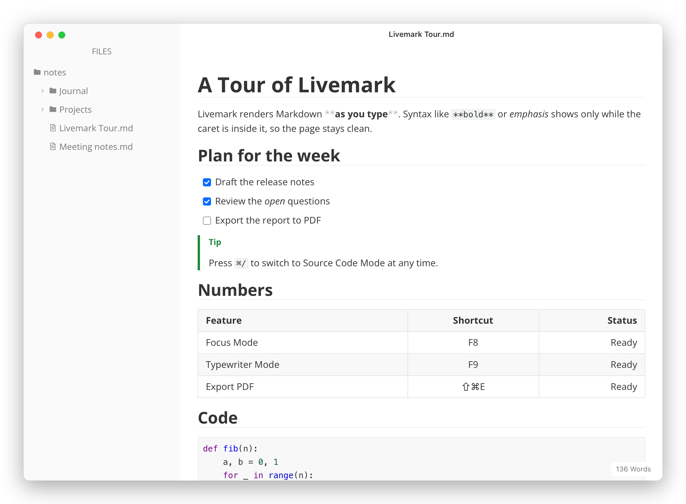
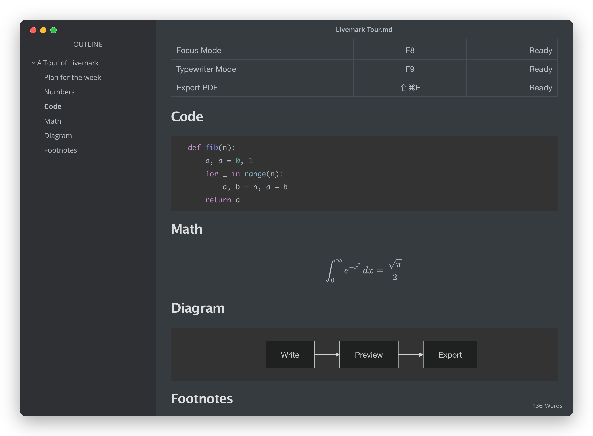

<div align="center">


# Livemark

**A live-preview Markdown editor for macOS and the browser, written from scratch.**

What you type renders in place, and the Markdown syntax appears only around the caret.

[](LICENSE)


English | [简体中文](README.zh-CN.md)

</div>

> [!NOTE]
> **For learning and research only.** This is a personal study project on how live-preview Markdown editors work. All code is written from scratch. It is not affiliated with Typora or its developers.

<p align="center">
  <picture>
    <source media="(prefers-color-scheme: dark)" srcset=".github/assets/screenshot-dark.png">
    
  </picture>
</p>

## Features

- **Live preview.** Headings, lists, tables, code, math and diagrams render as you type; the syntax of the token under the caret stays visible so you can edit it.
- **Full Markdown.** GitHub-style alerts, task lists, footnotes, front matter, `[toc]`, emoji shortcodes, highlight, sub/superscript and HTML blocks (sanitised).
- **Code, math and diagrams.** Syntax highlighting for 193 languages (highlight.js), KaTeX math with equation numbering, and Mermaid diagrams.
- **Saves only what you changed.** Untouched parts of a document are written back byte for byte, in their original style.
- **Files and folders.** File tree, file list with previews, outline, Quick Open, search in folder, TextBundle and TextPack, auto save and version history.
- **Export.** PDF (with bookmarks and internal links), HTML, PNG/JPEG, and Word, Epub, LaTeX and more through pandoc.
- **Writing modes.** Source Code Mode, Focus Mode, Typewriter Mode and a read-only mode.
- **Native on the Mac.** Native menus, tabs, Touch Bar, sharing, Quick Look, Dock menu and a Unibody window style.
- **Themes.** Six built-in themes with a separate dark-mode choice, plus your own CSS.
- **Bilingual interface.** English and Simplified Chinese.

<details>
<summary><b>Dark mode</b></summary>
<br>

</details>

## Getting started

### Mac app

Requires macOS 12 or later and the Xcode command-line tools (`xcode-select --install`).

```bash
git clone https://github.com/szy1840/Livemark.git
cd Livemark
./native/build.sh
open dist/Livemark.app
```

Drag `dist/Livemark.app` into Applications to install it.

### In the browser

Requires Node.js 18 or later.

```bash
npm start
```

Then open <http://localhost:4173>. Opening folders needs Chrome or Edge; image export, pandoc and custom themes are Mac-only.

## Development

| Command | What it does |
| :-- | :-- |
| `npm test` | Parser and round-trip checks |
| `./native/build.sh --test` | Build the app and run the shell self-test (bridge, files, menus, export) |
| `dist/Livemark.app/Contents/MacOS/Livemark --script check.js [doc.md]` | Run a script inside the app in a hidden window and print its result, for end-to-end checks |
| `node scripts/vendor.mjs` | Regenerate `vendor/` after upgrading dependencies |

There is no bundler and no build step for the web code: the editor is plain ES modules served as they are.

## How it works

- The shell is a native Swift app (`native/`) that hosts the editor in a web view; the two talk through `src/platform.js`, which also has a browser implementation.
- The document is a flat array of immutable paragraph objects. Typing is handled natively by a `contenteditable`, and only the changed paragraph is redrawn, so input stays instant even in long documents.
- Markdown markers are never removed from the text, only hidden. When the caret enters a token its markers are shown again.
- Undo snapshots are just array references, which makes them nearly free.
- On save, blocks that were not edited are copied from the original file, so diffs stay minimal.

### Project structure

```
src/        editor core, Markdown parser, commands, application shell
styles/     editor, interface and theme styles
native/     Swift sources and build script for the Mac app
docs/       built-in help documents
vendor/     bundled third-party libraries and fonts
test/       parser and round-trip tests
```

## Acknowledgements

Livemark bundles [KaTeX](https://katex.org), [Mermaid](https://mermaid.js.org), [highlight.js](https://highlightjs.org), [Prettier](https://prettier.io), [node-emoji](https://github.com/omnidan/node-emoji) and fonts from [Fontsource](https://fontsource.org). See [THIRD_PARTY_NOTICES.md](THIRD_PARTY_NOTICES.md) for their licences.

## Disclaimer

This project is for learning and research only. It is an independent project with no connection to Typora or its developers; Typora is mentioned only as the editor whose behaviour was used for comparison. It contains none of Typora's source code, style sheets, icons or name, and no licensing, auto-update or analytics features.

## License

[0BSD](LICENSE). Use, copy, modify and distribute freely; no attribution required. Bundled third-party components keep their own licences.
