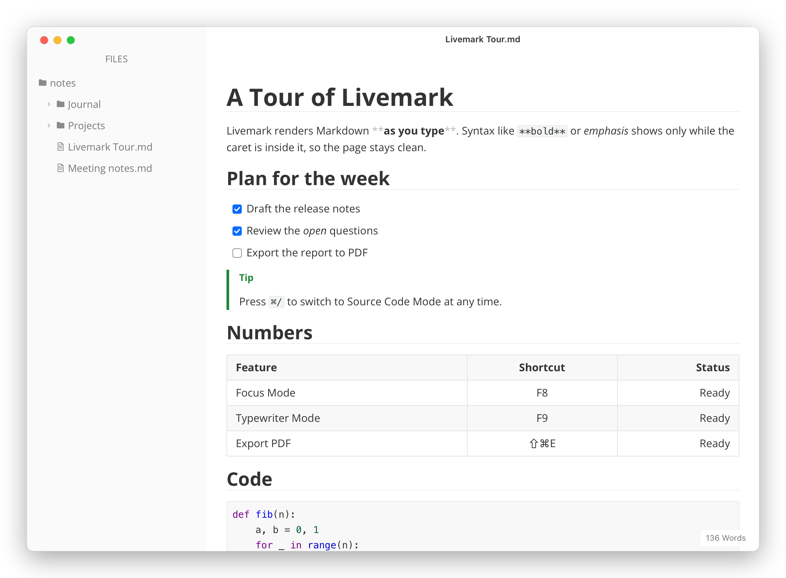
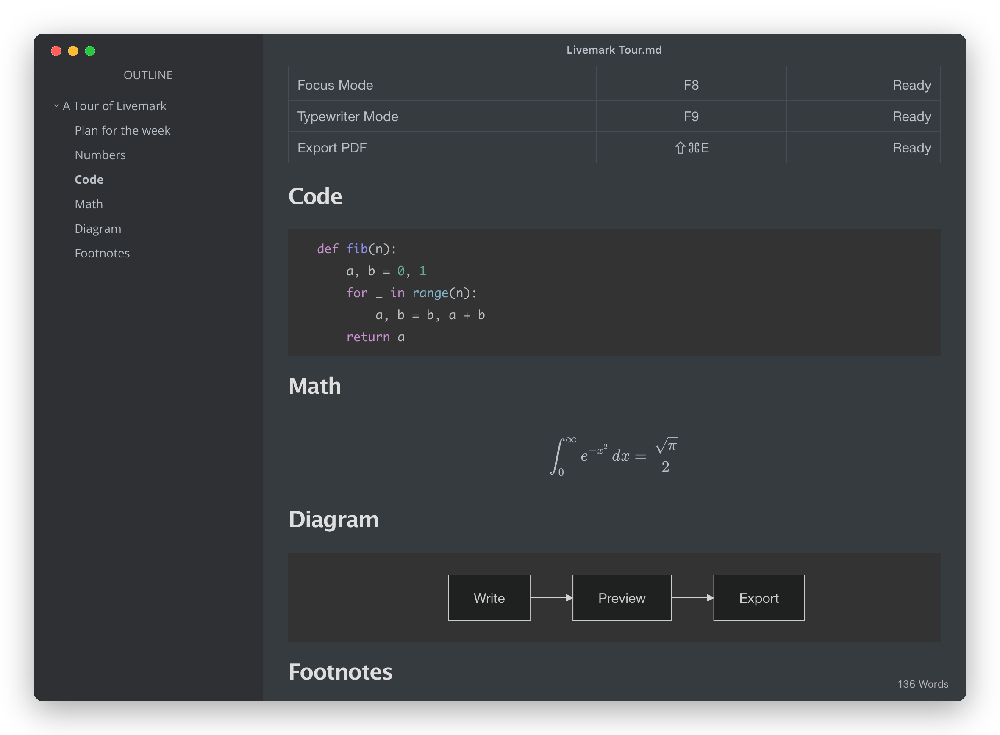

<div align="center">


# Livemark

**一个从零编写的即时渲染 Markdown 编辑器，支持 macOS 和浏览器。**

输入的内容当场渲染，Markdown 符号只在光标附近显示。

[](LICENSE)


[English](README.md) | 简体中文

</div>

> [!NOTE]
> **本项目仅供学习和研究使用。** 这是一个个人练手项目，用来学习即时渲染 Markdown 编辑器的设计思路。代码全部从零编写，与 Typora 及其开发者没有任何关系。

<p align="center">
  <picture>
    <source media="(prefers-color-scheme: dark)" srcset=".github/assets/screenshot-dark.png">
    
  </picture>
</p>

## 功能

- **即时渲染**：标题、列表、表格、代码、公式和图表边写边渲染；光标所在的标记保留语法符号，方便修改。
- **完整的 Markdown**：GitHub 风格提示块、任务列表、脚注、Front Matter、`[toc]`、表情短代码、高亮、上下标、HTML 块（已做安全过滤）。
- **代码、公式、图表**：193 种语言的代码高亮（highlight.js）、KaTeX 公式及自动编号、Mermaid 图表。
- **只保存改动的部分**：没碰过的内容逐字节原样写回，保留原来的写法。
- **文件和文件夹**：文件树、带预览的文件列表、大纲、快速打开、在文件夹中搜索、TextBundle 和 TextPack、自动保存和历史版本。
- **导出**：PDF（带书签和文内跳转）、HTML、PNG/JPEG，以及通过 pandoc 导出 Word、Epub、LaTeX 等。
- **写作模式**：源代码模式、专注模式、打字机模式、只读模式。
- **原生 Mac 体验**：原生菜单、标签页、Touch Bar、系统分享、Quick Look、Dock 菜单、Unibody 窗口风格。
- **主题**：六套内置主题，可单独指定深色模式的主题，也可以用自己的 CSS。
- **双语界面**：英文和简体中文。

<details>
<summary><b>深色模式</b></summary>
<br>

</details>

## 快速开始

### Mac 应用

需要 macOS 12 或更高版本，以及 Xcode 命令行工具（`xcode-select --install`）。

```bash
git clone https://github.com/szy1840/Livemark.git
cd Livemark
./native/build.sh
open dist/Livemark.app
```

把 `dist/Livemark.app` 拖进“应用程序”即可安装。

### 浏览器版

需要 Node.js 18 或更高版本。

```bash
npm start
```

然后打开 <http://localhost:4173>。打开文件夹需要 Chrome 或 Edge；导出图片、pandoc 和自定义主题只在 Mac 应用里有。

## 开发

| 命令 | 作用 |
| :-- | :-- |
| `npm test` | 解析器和往返检查 |
| `./native/build.sh --test` | 构建应用并跑外壳自检（桥接、文件、菜单、导出） |
| `dist/Livemark.app/Contents/MacOS/Livemark --script check.js [doc.md]` | 在隐藏窗口里运行脚本并打印结果，用于端到端检查 |
| `node scripts/vendor.mjs` | 升级依赖后重新生成 `vendor/` |

网页部分没有打包工具，也没有构建步骤：编辑器就是原样提供的 ES 模块。

## 实现原理

- 外壳是原生 Swift 应用（`native/`），在 Web 视图里加载编辑器；两边通过 `src/platform.js` 通信，它同时也有浏览器版的实现。
- 文档是一个由不可变段落对象组成的扁平数组。打字由 `contenteditable` 原生完成，只重绘被改动的那一段，所以长文档里输入也不卡。
- Markdown 符号从不从文本里删除，只是隐藏；光标进入某个标记时，它的符号重新显示。
- 撤销快照只是数组引用，几乎没有开销。
- 保存时，没编辑过的块直接从原文件复制，所以差异最小。

### 目录结构

```
src/        编辑器核心、Markdown 解析、编辑命令、应用外壳
styles/     编辑区、界面和主题样式
native/     Mac 应用的 Swift 源码和构建脚本
docs/       内置帮助文档
vendor/     打包进来的第三方库和字体
test/       解析和往返测试
```

## 致谢

Livemark 内置了 [KaTeX](https://katex.org)、[Mermaid](https://mermaid.js.org)、[highlight.js](https://highlightjs.org)、[Prettier](https://prettier.io)、[node-emoji](https://github.com/omnidan/node-emoji) 以及来自 [Fontsource](https://fontsource.org) 的字体，它们的许可见 [THIRD_PARTY_NOTICES.md](THIRD_PARTY_NOTICES.md)。

## 免责声明

本项目仅供学习和研究使用。它是独立项目，和 Typora 及其开发者没有任何关系；文中提到 Typora 只是为了说明行为对照的对象。项目不包含 Typora 的任何源码、样式文件、图标或名称，也没有授权、自动更新和统计相关的功能。

## 许可

[0BSD](LICENSE)：可以随意使用、复制、修改和分发，不需要保留署名。内置的第三方组件各自沿用原许可。
