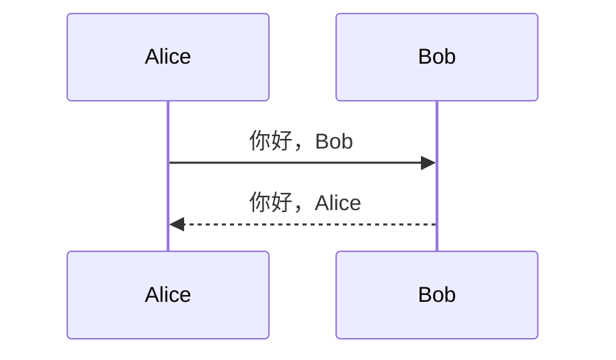

# Markdown 参考

[toc]

## 块级元素

### 段落和换行

直接打字就是段落，按回车开始新段落。按 Shift+回车在段落内换行。

### 标题

行首输入 1 到 6 个 `#` 加空格。`⌘1` 到 `⌘6` 直接设置级别，`⌘0` 恢复成正文，`⌘=` 和 `⌘-` 提升或降低一级。

### 引用

行首输入 `>` 加空格。再输入一次得到嵌套引用。在空的引用行上按回车退出一层。

> 引用里可以放任何内容。
>
> > 包括另一层引用。

### 提示块

引用的第一行写 `[!NOTE]`、`[!TIP]`、`[!IMPORTANT]`、`[!WARNING]` 或 `[!CAUTION]`。

> [!WARNING]
> 这是一个警告。

### 列表

- 无序列表：`-`、`*` 或 `+` 加空格
- 有序列表：数字加点加空格，如 `1. `
- 任务列表：在无序列表项里输入 `[ ] ` 或 `[x] `

按 Tab 缩进成子项，Shift+Tab 退回。在空的列表项上按回车退出列表。

1. 第一项
2. 第二项
   - 子项
   - [x] 完成的任务
   - [ ] 未完成的任务

### 代码块

输入三个反引号（后面可以跟语言名）再回车。右下角可以改语言。按 `⌘↩` 跳到代码块下方。

```python
def greet(name):
    return f"你好，{name}"
```

### 公式块

输入 `$$` 再回车，里面写 LaTeX。

$$
\frac{n!}{k!(n-k)!} = \binom{n}{k}
$$

### 图表

语言名写 `mermaid` 的代码块会画成图表。也兼容旧式的 `sequence` 和 `flow` 写法。



### 表格

输入 `|第一列|第二列|` 再回车。光标在表格里时，表格右上方有对齐、增删行列的工具。Tab 到下一格，回车到下一行，`⌘↩` 在下方插入一行。

| 左对齐 | 居中 | 右对齐 |
| :-- | :-: | --: |
| a | b | c |

### 分隔线

单独一行输入 `---` 或 `***` 再回车。

---

### 目录

单独一行输入 `[toc]` 再回车，会根据标题自动生成并保持更新。

### YAML Front Matter

在文档最开头输入 `---` 再回车。

### 脚注

正文里写 `[^1]`，另起一行写 `[^1]: 脚注内容`。菜单“段落 → 脚注”会自动编号并生成定义[^demo]。

[^demo]: 这是一条脚注。

### 链接引用

正文里写 `[文字][id]`，另起一行写 `[id]: https://example.com "标题"`。

### HTML 块

以 `<div>`、`<details>`、`<iframe>`、`<video>` 等标签开头的段落按 HTML 渲染，脚本会被去掉。

<details>
<summary>点开看看</summary>
这里是折叠的内容。
</details>

## 行内元素

| 写法 | 效果 | 快捷键 |
| :-- | :-- | :-- |
| `**粗体**` | **粗体** | ⌘B |
| `*斜体*` | *斜体* | ⌘I |
| `<u>下划线</u>` | <u>下划线</u> | ⌘U |
| `` `代码` `` | `代码` | ⌃` |
| `~~删除线~~` | ~~删除线~~ | ⌃⇧` |
| `==高亮==` | ==高亮== | ⇧⌘H |
| `H~2~O` | H~2~O | |
| `x^2^` | x^2^ | |
| `$a^2+b^2$` | $a^2+b^2$ | ⌃M |
| `:smile:` | :smile: | |
| `[文字](网址)` | [文字](https://example.com) | ⌘K |
| `<https://example.com>` | <https://example.com> | |
| `` | 图片 | ⌃⌘I |
| `<!-- 注释 -->` | 只在编辑时可见 | ⌃- |
| `\*` | \* | |

### 图片

可以直接粘贴或拖入图片。文档保存过以后，图片会存进文档旁边的 `assets` 文件夹（可在偏好设置里改）。光标在图片上时，菜单“格式 → 图片”里可以缩放或切换成 `` 写法。

### 链接

按住 ⌘ 点击链接可以打开。`[回到顶部](#markdown-参考)` 这样的链接会跳到对应标题，指向其他 `.md` 文件的相对链接会直接在这里打开。
