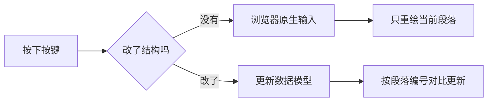

# 欢迎使用 Livemark

这是一个**所见即所得**的 Markdown 编辑器：没有预览窗格，你打的字*就地*变成排版好的样子。把光标移进这段里的粗体或 `行内代码`，语法符号会原地显现；移开又收起。

[toc]

## 试一试

- 新起一行，输入 `# ` 加空格，变成标题；`- ` 变成列表；`> ` 变成引用
- 输入三个反引号加语言名再回车，得到代码块；输入 `$$` 再回车，得到公式块
- 输入 `|姓名|城市|` 再回车，得到表格，用 Tab 在单元格间移动
- [x] 点左边的方框可以勾选任务
- [ ] 在列表里按 Tab 缩进，Shift+Tab 退回
  1. 列表可以嵌套
  2. 列表项里还能放段落和代码块

行内格式有 **粗体**、*斜体*、~~删除线~~、<u>下划线</u>、`代码`、表情 :tada: 和 [链接](https://commonmark.org)。脚注写成这样[^1]。高亮、上下标和行内公式默认关闭，可以在“设置 → Markdown”里打开。

> [!TIP]
> 这是一个提示块。引用里可以继续嵌套：
>
> > 第二层引用
>
> - 也可以放列表

## 公式、代码和图表

$$
\int_{-\infty}^{\infty} e^{-x^2}\,dx = \sqrt{\pi}
$$

```js
// 只重绘光标所在的那一个段落
function brush(block) {
  const html = renderInline(block.text);
  if (html !== block.el.innerHTML) block.el.innerHTML = html;
}
```



## 表格

| 快捷键 | 作用 |
| :-- | :-- |
| ⌘B / ⌘I / ⌘K | 粗体、斜体、链接 |
| ⌘1 – ⌘6，⌘0 | 标题级别，恢复正文 |
| ⌘F / ⌥⌘F | 查找、查找并替换 |
| ⌘/ | 源代码模式 |
| F8 / F9 | 专注模式、打字机模式 |
| ⇧⌘O | 快速打开 |

完整的列表在菜单“帮助 → 快捷键”里。

---

## 它为什么跟手

1. **打字交给浏览器。** 普通按键不经过任何脚本，字符由原生输入直接落到页面上，所以没有延迟。
2. **只刷一个段落。** 按键落下后，只有光标所在的段落被重新解析；如果算出来的结构和页面上已有的一样，就什么都不改。
3. **符号一直都在。** `**` 这些标记始终留在页面里，只是被样式藏起来。光标进入时翻一个开关就显示，不需要重新渲染。
4. **结构操作走模型。** 回车、段首退格、粘贴、跨段删除这些会改变文档结构的操作，先改数据，再按段落编号对比更新页面。

[^1]: 脚注的内容写在文档任意位置，按住 ⌘ 点击上面的编号可以跳到这里。
